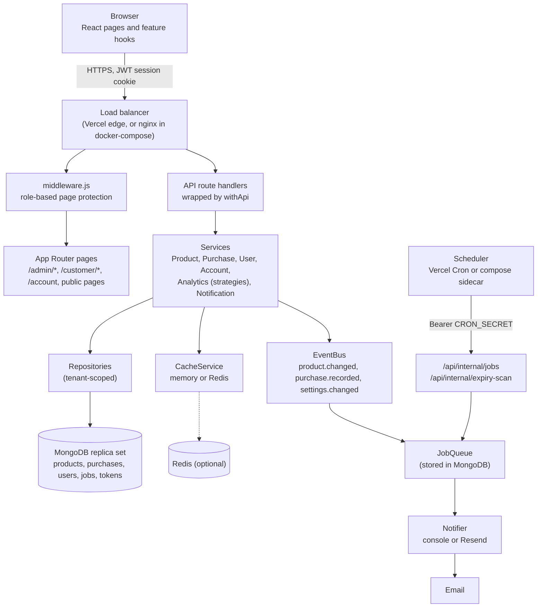

# TrackIt

Supermarket inventory and expiry tracking: store administrators manage stock, record sales and get expiry alerts and demand forecasts, while customers see their purchases, spending and the items in their basket that are about to expire.

    

Deployment linked from the author's portfolio: <https://inv-gdg.vercel.app/home>

More documentation: [Architecture](docs/ARCHITECTURE.md) · [HTTP API](docs/API.md) · [Runbook and go-live checklist](docs/RUNBOOK.md) · [Architecture decision records](docs/adr/)

## Overview

Small supermarkets lose money on stock that expires unnoticed, and they often track inventory in spreadsheets that cannot answer "what is about to expire, what is running low, and what will sell next week?". Their customers have the same problem at home: they forget what they bought and when it expires.

TrackIt is a multi-tenant web app with two roles:

- **Administrator** (one per store): manages the store's products, records sales at the counter against a registered customer, and gets dashboards, an expiry calendar, low-stock and expiry alerts, sales reports and a demand forecast.
- **Customer**: sees purchase history across every TrackIt store they buy from, spending per week, month and store, a personal budget, and alerts for purchased items that are about to expire.

The code is structured as a production-minded modular monolith (layered services, durable job queue, caching, rate limiting, tests and CI) and is designed for a pilot of a few stores; see the scale estimates and trade-offs in [docs/ARCHITECTURE.md](docs/ARCHITECTURE.md).

## Key features

**Store administrators**
- Product management: add, edit and soft-delete products with category, price, stock, expiry date, barcode (unique per store) and optional image.
- Inventory browser with search, category and expiry filters, sorting (newest, expiry, stock, name) and pagination.
- Record a sale: pick products, choose the customer by email, and generate a receipt. Stock is decremented atomically in a MongoDB transaction (all lines or none), prices come from the database, and expired products can never be sold.
- Dashboard tabs: overview KPIs and low stock, inventory, expiry alerts, expiry calendar, sales reports (daily, weekly, monthly) and predictive analysis.
- Predictive analysis: demand from a moving average of recent sales, a 7-day sales forecast from a least-squares linear trend, expiry-risk scores, category performance and recommendations. This is a transparent heuristic, not a trained ML model, and the UI states the method.
- Email notifications: a daily expiry digest and low-stock alerts, with configurable thresholds.

**Customers**
- Dashboard, purchase history, "My Stores", expiry alerts for purchased items, and a weekly or monthly budget.

**Accounts and privacy**
- Registration for both roles, login, logout, forgot and reset password, optional email verification, password change.
- Data export (streamed JSON download) and account deletion; sales are kept for the store but unlinked from the deleted person.
- Public landing page (with a shrinkage calculator), about, contact form, privacy policy and terms.
- An embedded Jotform AI assistant, loaded only for signed-in users ([`src/components/ChatbotScript.jsx`](src/components/ChatbotScript.jsx)).

**Engineering**
- Layered backend: thin route handlers, services, repositories, with dependency injection through a single composition root.
- Tenant isolation: every query is scoped by `storeId` or `customerId`; other stores' data returns 404.
- Durable job queue in MongoDB (retries with backoff, dead-lettering, idempotent dedupe keys) for emails and alerts.
- Cache-aside caching (in-memory by default, Redis when configured) with event-based invalidation and stampede protection.
- Rate limiting, Zod input validation, security headers and CSP, structured JSON logs with secret redaction, optional Sentry.
- Health endpoints for load balancers, a Docker image, a docker-compose topology with nginx and two replicas, and GitHub Actions CI.

## Architecture



| Component | Location | Role |
| --- | --- | --- |
| Pages and UI | `src/app/`, `src/features/`, `src/components/` | Next.js App Router pages; feature modules (admin, customer, products, auth, account) with hooks for data and presentational components; shadcn/Radix UI primitives. |
| Route protection | `src/middleware.js` | Server-side redirect for `/admin/*`, `/customer/*` and `/account/*` unless the session has the right role. |
| API layer | `src/app/api/**/route.js`, `src/server/core/http.js` | Thin handlers wrapped by `withApi`, which applies authentication, role checks, session revocation, rate limiting, validation, error mapping and request logging. |
| Services | `src/server/services/` | Business use cases. Analytics uses one strategy class per `(role, type)` report. |
| Repositories and models | `src/server/repositories/`, `src/server/db/models/` | Mongoose data access, always scoped by tenant; atomic conditional stock updates. |
| Cache | `src/server/cache/` | `CacheStore` interface (memory LRU or Redis) and a cache-aside service with version-based invalidation. |
| Messaging | `src/server/messaging/` | In-process `EventBus`, durable `JobQueue` and notifiers (`console` or Resend). |
| Composition root | `src/server/container.js` | Wires every dependency in one place; tests override it. |
| Config | `src/server/config/` | Environment validated at startup; tunables as named constants. |
| Shared logic | `src/shared/` | Constants and expiry rules used by both client and server. |

The design decisions (layering, MongoDB-based queue, caching, pagination) are recorded in [docs/adr/](docs/adr/).

## How it works

**Recording a sale** (`POST /api/purchases`)
1. `withApi` checks the session, requires the Administrator role, applies the write rate limit and connects to the database.
2. The body is validated against a Zod schema (whitelisted fields, quantities of at least 1).
3. The customer is resolved by email and must be a Customer account.
4. In one transaction, each line runs a conditional update (`stock >= quantity` and not expired, scoped to the store). Any miss aborts the whole sale. The purchase is inserted with a server-computed total.
5. A `purchase.recorded` event invalidates the store's and customer's cache namespaces and enqueues a low-stock alert if needed. The queue is drained right after the response is sent.

**Loading a dashboard** (`GET /api/analytics?type=inventory`)
`AnalyticsService` selects the strategy for the caller's role and report type, checks the cache, and on a miss runs a single `$facet` aggregation in MongoDB, so the response size does not depend on inventory size.

**Daily expiry digest**
The scheduler calls `/api/internal/expiry-scan`, which enqueues one digest job per store per day (deduplicated). The job worker (`/api/internal/jobs`) sends the emails, retrying with exponential backoff and dead-lettering after repeated failures.

## Tech stack

| Layer | Technologies |
| --- | --- |
| Framework | Next.js 15 (App Router, standalone output), React 19 |
| UI | Tailwind CSS v4, Radix UI / shadcn components, Recharts, Framer Motion, `react-day-picker`, `lucide-react` |
| Auth | NextAuth 4 (credentials provider, JWT sessions), bcryptjs |
| Data | MongoDB with Mongoose 8 (replica set required for transactions) |
| Validation | Zod |
| Cache and rate limits | In-memory, or Redis via `ioredis` |
| Email | Resend (or console output for development) |
| Observability | Structured JSON logger with redaction, `/api/health`, optional Sentry (`@sentry/nextjs`) |
| Testing | Vitest, `mongodb-memory-server`, Playwright, `@axe-core/playwright` |
| Delivery | Docker (multi-stage, Node 22 Alpine), docker-compose with nginx, GitHub Actions, Vercel (with cron) |

## Project structure

```text
src/
  app/                 Next.js pages and thin API route handlers
    admin/             dashboard, add-product, edit-product/[id], record-sale
    customer/          customer dashboard
    api/               register, products, purchases, analytics, me, account, contact, health, internal/*
  features/            UI feature modules (admin, customer, products, auth, account): hooks + components
  components/          shared components and shadcn/Radix primitives (components/ui)
  lib/api-client.js    fetch wrapper + useApi hook
  shared/              constants and expiry logic shared by client and server
  server/
    auth/              NextAuth options
    config/            validated env + tunables (no magic numbers)
    core/              errors, logger (redacting), withApi decorator, rate limiter, pagination
    cache/             CacheStore interface (memory / Redis) + cache-aside service
    db/                connection singleton + Mongoose models (User, Product, Purchase, Job, AuthToken)
    repositories/      data access (tenant-scoped, atomic stock updates)
    services/          business use cases; analytics strategies; email templates
    messaging/         EventBus (observer), JobQueue (durable, retries), notifiers
    validation/        Zod schemas
    container.js       composition root (dependency injection)
  middleware.js        role-based route protection
tests/                 unit + integration (Vitest, mongodb-memory-server); tests/e2e = Playwright
scripts/               smoke test, load test, e2e server, sample-data seeder
deploy/                nginx load balancer config, scheduler script
docs/                  architecture, API, runbook, ADRs
Dockerfile, docker-compose.yml, vercel.json, .github/workflows/ci.yml
```

## Getting started

### Prerequisites

- Node.js 20.9 or newer (CI and the Docker image use Node 22)
- MongoDB 7+ running as a **replica set** (sales are recorded in transactions); MongoDB Atlas clusters already are
- Optional: Redis, Docker

### Quick start (local)

```bash
npm ci
cp .env.example .env.local        # fill NEXTAUTH_SECRET (openssl rand -base64 32) and CRON_SECRET
start-mongodb.bat                 # Windows: starts mongod --replSet rs0 and initiates it
# macOS/Linux: mongod --replSet rs0 --dbpath ./data/db &  then  mongosh --eval "rs.initiate()"
npm run dev                       # http://localhost:3000
```

Register a store administrator at `/administratorsignup` and a customer at `/customersignup`.

To load sample data, [`scripts/seed-store.mjs`](scripts/seed-store.mjs) inserts 50 supermarket products for a store: `node scripts/seed-store.mjs "<MONGODB_URI>" [shopName]`. Read the script before running it: if no matching administrator exists, it creates one with a default password that you should change immediately.

### Production-like stack (load balancer, 2 replicas, Redis, scheduler)

```bash
cp .env.example .env              # set NEXTAUTH_SECRET and CRON_SECRET
docker compose up --build         # http://localhost:8080
```

This starts MongoDB (single-node replica set), Redis, two app replicas behind nginx (`least_conn`) and a scheduler sidecar that calls the internal endpoints.

### Environment variables

All variables are documented in [`.env.example`](.env.example). The app validates them at startup and refuses to start without the required ones.

| Name | Required | Purpose |
| --- | --- | --- |
| `MONGODB_URI` | yes | MongoDB connection string (must be a replica set) |
| `NEXTAUTH_SECRET` | yes | Signs session JWTs |
| `NEXTAUTH_URL`, `APP_URL` | yes | Public base URL, used in emailed links |
| `CRON_SECRET` | yes | Bearer token for `/api/internal/*` |
| `REDIS_URL` | no | Shared cache and rate limits across instances (unset = in-process memory) |
| `MONGODB_READ_PREFERENCE` | no | `primary`, `secondaryPreferred` or `nearest` for read-heavy queries |
| `MONGODB_MAX_POOL_SIZE` | no | Connection pool size per instance (use a small value on serverless) |
| `MONGODB_AUTO_INDEX` | no | Set `false` to skip index builds on startup |
| `NOTIFIER` | no | `console` (emails written to the log) or `resend` |
| `RESEND_API_KEY`, `NOTIFY_FROM` | with Resend | Resend API key and sender address |
| `SUPPORT_EMAIL` | no | Receives contact-form messages; shown on legal pages |
| `APP_TIMEZONE` | no | Day boundaries for digests and charts |
| `ALLOW_ADMIN_SIGNUP` | no | `false` makes store-admin accounts invite-only |
| `REQUIRE_EMAIL_VERIFICATION` | no | `true` blocks sign-in until the email is confirmed (needs Resend) |
| `LOG_LEVEL` | no | Logger verbosity |
| `LEGAL_ENTITY_NAME`, `LEGAL_LAST_UPDATED` | no | Operator name and date on `/privacy` and `/terms` |
| `SENTRY_DSN`, `SENTRY_TRACES_SAMPLE_RATE` | no | Server-side error tracking |

### Scripts and tests

| Command | What it does |
|---|---|
| `npm run dev` / `build` / `start` | Next.js dev server / production build / production server |
| `npm run lint` | ESLint (Next.js core-web-vitals rules) |
| `npm test` | Unit + integration tests (spins up an in-memory MongoDB replica set) |
| `npm run test:unit` / `test:integration` | Run only one of the two suites |
| `npm run test:coverage` | Tests with coverage for `src/server` and `src/shared` |
| `npm run build && npm run test:e2e` | Browser tests (Playwright) + axe accessibility checks against the production build, on an isolated in-memory database. First time: `npx playwright install chromium` |
| `npm run test:smoke` | End-to-end regression suite against a running server (`BASE_URL`, optional `CRON_SECRET`) |
| `npm run load-test` | Latency percentiles for hot endpoints (`BASE_URL`, `CONCURRENCY`, `REQUESTS`, `SEED`) |

Tip (Windows/offline): set `MONGOMS_SYSTEM_BINARY` to your local `mongod.exe` so tests don't download MongoDB. On Windows run Vitest from PowerShell or cmd: Git Bash's lowercase `/d/` drive path makes Vitest load twice ("Cannot read properties of undefined (reading 'config')").

CI ([`.github/workflows/ci.yml`](.github/workflows/ci.yml)) runs lint, `npm audit --omit=dev`, tests with coverage and a build on every push to `main` and every pull request, then the Playwright and accessibility suite.

Going live? Follow the checklist at the top of [docs/RUNBOOK.md](docs/RUNBOOK.md).

## API overview

Full reference: [docs/API.md](docs/API.md). Errors share one shape with a machine-readable `code` (for example `VALIDATION_ERROR`, `INSUFFICIENT_STOCK`, `PRODUCT_EXPIRED`, `RATE_LIMITED`).

| Endpoint | Who | Purpose |
| --- | --- | --- |
| `POST /api/register` | public | Create a Customer or Administrator account |
| `POST /api/auth/callback/credentials` | public | Sign in (NextAuth credentials) |
| `POST /api/account/password/forgot`, `/reset`, `/api/account/verify-email[/resend]` | public | Password recovery and email confirmation |
| `GET, POST /api/products` · `GET, PUT, DELETE /api/products/:id` | Administrator | Manage and list the store's products |
| `GET, POST /api/purchases` | Administrator, Customer | Record a sale (admin); list sales or purchases with keyset pagination |
| `GET /api/analytics?type=...&period=...` | both | Reports: `inventory`, `sales`, `expiry`, `predictive` (admin); `spending`, `expiry` (customer) |
| `GET, PATCH /api/me/settings` | signed in | Notification thresholds and budget |
| `GET, DELETE /api/me` · `GET /api/me/export` · `POST /api/me/password` | signed in | Account details, deletion, data export, password change |
| `POST /api/contact` | public | Contact form |
| `GET /api/health` | public | Readiness (`?probe=live` for liveness) |

Example: record a sale.

```http
POST /api/purchases
Content-Type: application/json

{ "customerEmail": "customer@example.com", "items": [{ "productId": "<id>", "quantity": 2 }], "paymentMethod": "Cash" }
```

Returns `201 { "purchase": { ... } }`, or `409` with `INSUFFICIENT_STOCK` or `PRODUCT_EXPIRED`, in which case nothing is written.

### Scheduled work

Call these with `Authorization: Bearer $CRON_SECRET` (Cloud Scheduler, Vercel Cron or the compose `scheduler`):

| Endpoint | Schedule | Purpose |
|---|---|---|
| `POST /api/internal/jobs` | every minute | drain the job queue (alerts, retries) |
| `POST /api/internal/expiry-scan` | daily, morning | enqueue one expiry digest per store (idempotent per day) |
| `POST /api/internal/db-indexes` | on each deploy | build declared indexes, drop obsolete ones |

[`vercel.json`](vercel.json) schedules `expiry-scan` and `jobs` once a day each (Vercel Hobby plan limits); jobs are also drained after each request and opportunistically from API traffic.

## Results

Measured on 2026-11-11 and recorded in [docs/ARCHITECTURE.md](docs/ARCHITECTURE.md#measured-results-2026-11-11-after-pilot-hardening) (single laptop, so treat latency figures as indicative):

| Check | Result |
| --- | --- |
| `npm audit --omit=dev` | 0 vulnerabilities |
| ESLint | 0 problems |
| Unit + integration tests | 80 passing |
| Playwright browser tests | 14 passing |
| Accessibility (axe, WCAG 2.1 A/AA) | 0 serious or critical violations on 18 screens (excluding the third-party Jotform widget) |
| API smoke suite | 48/48 |
| `GET /api/products`, 1 client | p50 6 ms / p95 9 ms |
| `GET /api/analytics?type=inventory`, 50 clients | 315 requests/s, p95 197 ms |
| Concurrency check | 12 simultaneous sales of a 3-unit product: exactly 3 succeed, final stock 0 |

## Security notes

- Secrets come only from the environment; the app refuses to start without them.
- **If you are upgrading from the pre-refactor code:** the old MongoDB Atlas password was committed to git history. Rotate it in Atlas and restrict network access; removing it from the code does not revoke it.
- Details (password hashing, token handling, session revocation, rate limits, CSP) are in the security section of [docs/ARCHITECTURE.md](docs/ARCHITECTURE.md).

## Limitations and roadmap

- Forecasting is a moving-average and linear-trend heuristic; there is no trained model yet.
- Offset pagination for products is designed for up to roughly 10k products per store; the in-memory cache is per instance unless Redis is configured; the MongoDB-backed queue has limited throughput compared with a managed broker (see [ADR 0002](docs/adr/0002-mongodb-job-queue.md)).
- The assistant is a third-party Jotform widget and is excluded from accessibility tests.
- On the Vercel Hobby plan, cron runs only once a day, so queued emails depend on request-driven draining between runs.

## Author

Built by [Suriyaprakash](https://github.com/suriyaprakash-25).
